# MY LAMP STACK IMPLEMENTATION IN AWS.

A LAMP stack is a set of four tools used to host dynamic websites:

- **L**: LINUX (Ubuntu Server on AWS EC2)
- **A**: APACHE (the web server)
- **M**: MYSQL (the database)
- **P**: PHP (the scripting language)

## WHAT I GAINED FROM DOING THIS PROJECT:

- Deepened my unmderstanding about linux terminal 
- Learnt how to create an AWS account, an EC2 instance and a basic understanding of how networking works on AWS.
- Understood how specific frameworks are picked and put together to make a software program run smoothly.
- An understanding of the difference between LAMP,LEMP,MERN and MEAN.

## IMPLEMENTATION WORKTHROUGH OF THE PROJECT 

This section documents how I built a LAMP stack (Linux, Apache, MySQL, PHP) on AWS from scratch, from creating the cloud server to serving my own website through an Apache virtual host. Every command I ran is shown with a screenshot, in the same order I did them, so the whole process can be followed or repeated.

| Cloud provider and instance type (AWS EC2,t3.micro )
| Operating system (Ubuntu Server 26.04 LTS)
| Web server (Apache2)
| Database (MySQL 8.4)
| Scripting language (PHP)

## Step 0 - CREATING AWS ACCOUNT AND EC2 INSTANCE:

### In order to complete this project i had to create an AWS account so i created a free tier AWS account and launched a t3.micro instance running Ubuntu and connected to it over SSH.

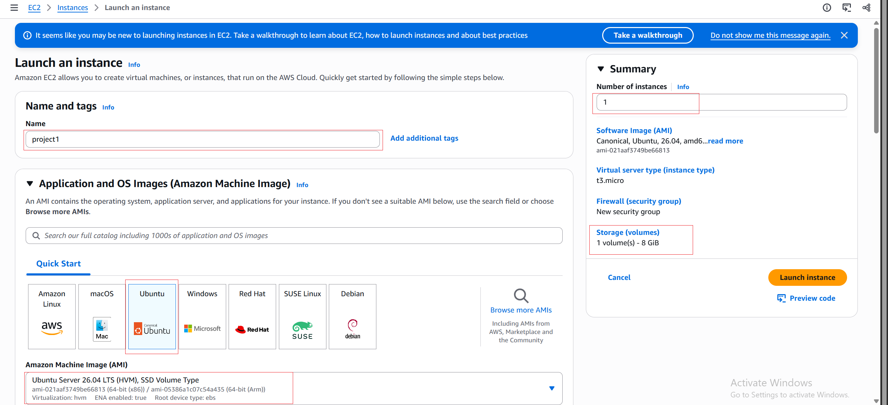
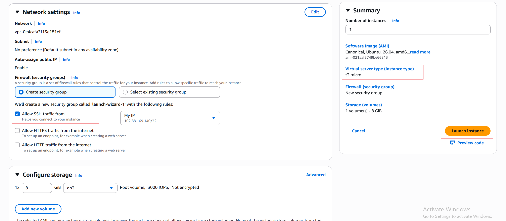
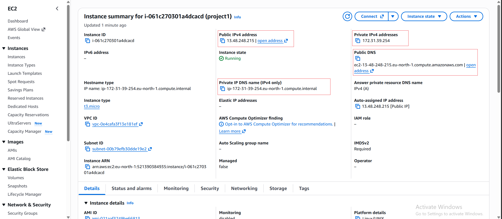

- **AMI: Ubuntu Server 26.04 LTS (HVM), SSD Volume Type**
- **Instance Type: t3.micro (Free Tier eligible)**
- **Storage: 8 GiB**
- **security group: Port 22 (SSH),inbound rule.**

### Successfully connecting to my EC2 instance running Ubuntu 26.04 LTS using my .pem key and public ip address 13.48.248.215.

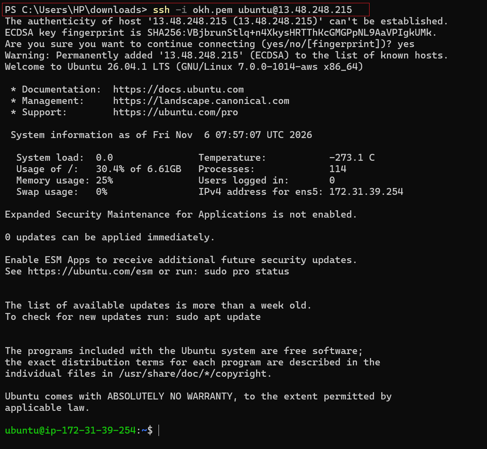

```bash
ssh -i okh.pem ubuntu@13.48.248.215
```

```bash
NOTE: On every start and stop of the EC2 instance, the public IP address changes — so always use the updated IP when reconnecting.
```

### After connecting to my instance through SSH i discovered i forgot to add port 80 (HTTP) that allow for external traffic to reach my instance so i went back to add port 80 to my security group.

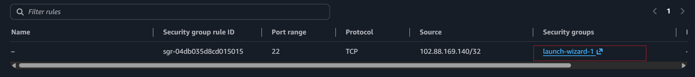

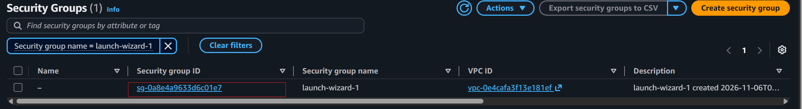

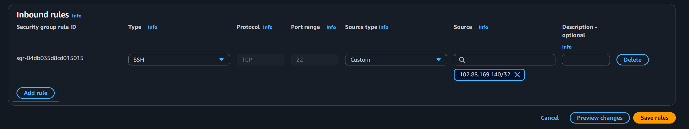

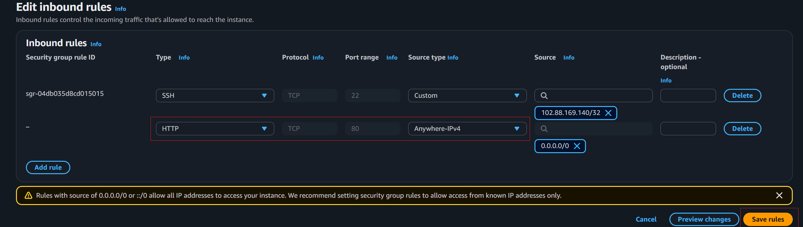

## STEP 1 - INSTALLING APACHE AND UPDATING THE FIRE WALL:

### I ran the following command to install and update Apache using Ubuntu package manager "apt"

```bash
# Update a list of packages in package manager
sudo apt update 
```
```bash
# Run apache2 package installation
sudo apt install apache2
```
```bash
# To verify if Apache2 is running as a service on my OS 
sudo systemctl status apache2
```
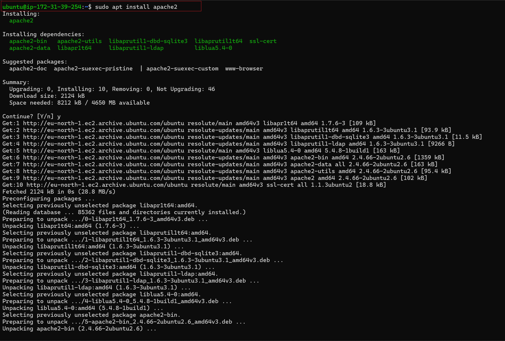

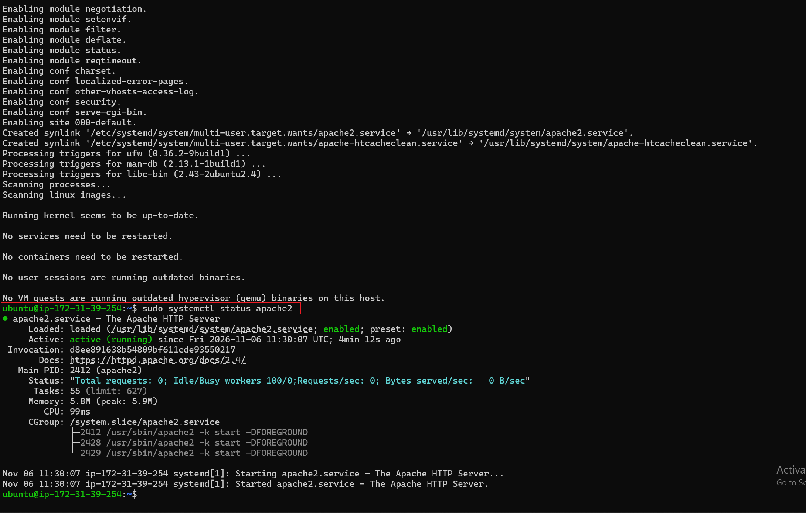

### Apache is installed and is actively running.

### I had to first add Port 80 (http) which allow for external connection into my EC2 instance from anywhere.

### Verifying Apache locally:

```bash
http//:19.48.248.215:80
```

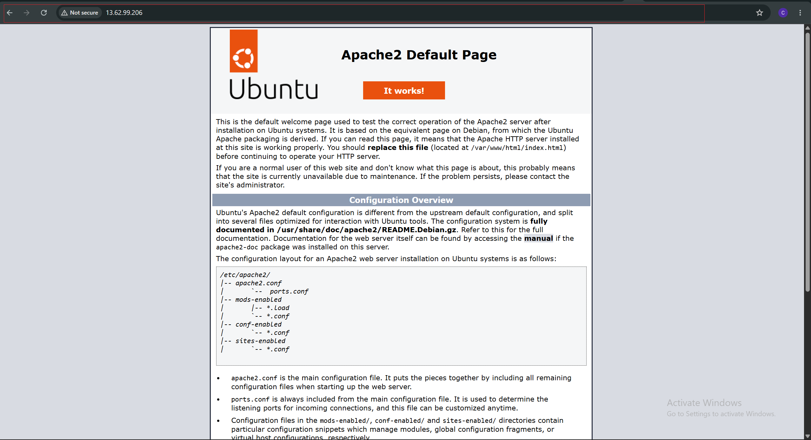

### Apache is live,the Ubuntu Apache2 Default Page loaded successfully.

## STEP 2 - INSTALLING MYSQL:

```bash
# Installing MYSQL
sudo apt install mysql-server
```
### When prompted, confirm installation by typing Y, and then ENTER.

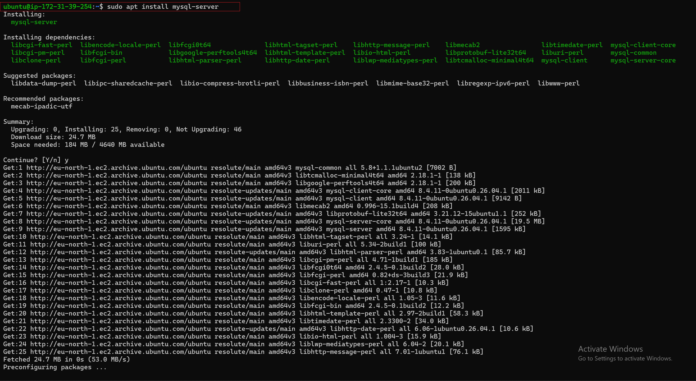

### After installing MSQL i ran the next commamd to set up root user password and connect to the Mysql administrative database user root

```bash
#Log into MYSQL console 
sudo mysql
```
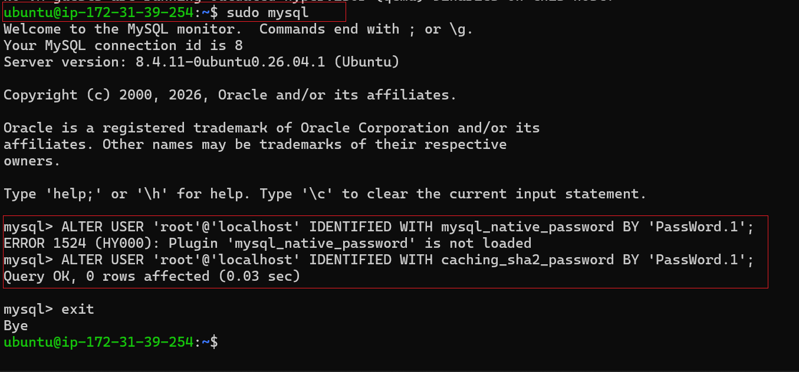

### Mysql_native_password was used in the older version MYSQL (8.0) where the pluggin was still enable but the newer version (8.4) uses "caching_sha2_password" as the default so i used it to create my password.

```bash
# Start the interactive script by running
sudo mysql_secure_installation
```
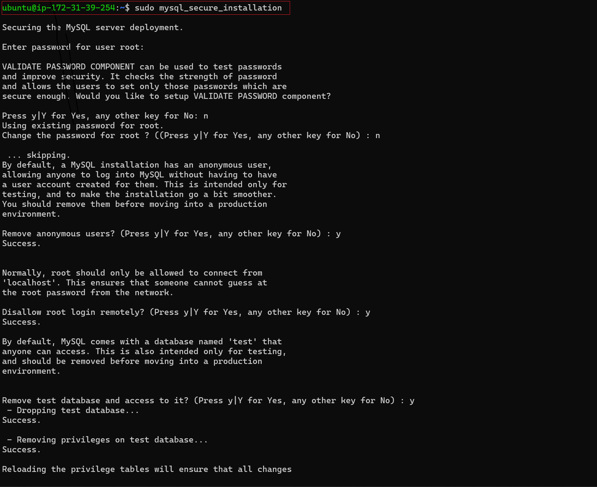
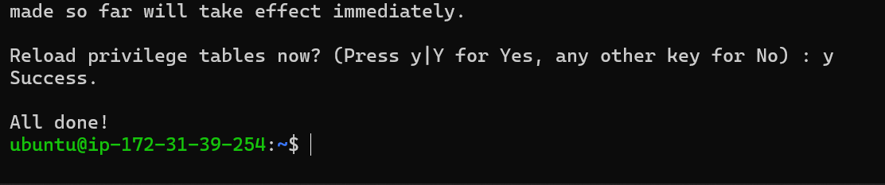

## STEP 3 — INSTALLING PHP: 

```bash
# Installing PHP and the required module for Mysql and Apache
sudo apt install php libapache2-mod-php php-mysql
```
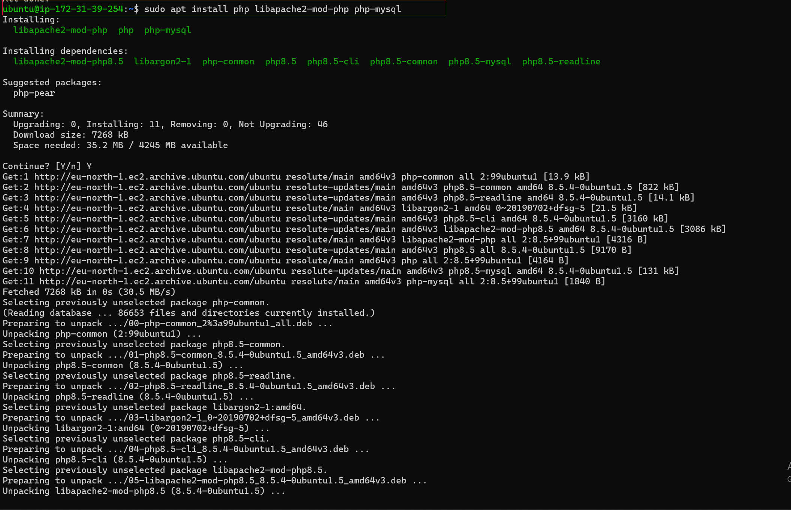

```bash 
# Verified PHP installation  
php -v 
```
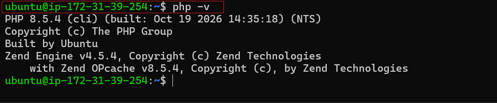

## STEP 4 — CREATING A VIRTUAL HOST FOR THE WEBSITE USING APACHE:

### Creating a directory for projectlamp using ‘mkdir’ command and assigning ownership of the directory with my current system user
```bash
sudo mkdir /var/www/projectlamp
sudo chown -R $USER:$USER /var/www/projectlamp
```

### Created and open a new configuration file in Apache’s sites-available directory

```bash
sudo vi /etc/apache2/sites-available/projectlamp.conf
```

```bash
<VirtualHost *:80>
    ServerName projectlamp
    ServerAlias www.projectlamp 
    ServerAdmin webmaster@localhost
    DocumentRoot /var/www/projectlamp
    ErrorLog ${APACHE_LOG_DIR}/error.log
    CustomLog ${APACHE_LOG_DIR}/access.log combined
</VirtualHost>
```
### Using ls command to show the new file in the sites-available directory

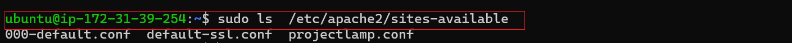

### Running the following command to enable the virtual host and disable the default website that comes installed with Apache.

```bash
sudo a2ensite projectlamp
sudo a2dissite 000-default
```
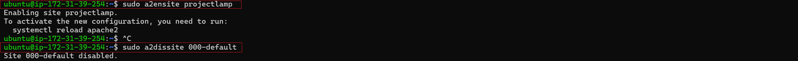

### Reload Apache so these changes take effect

```bash
sudo systemctl reload apache2
```

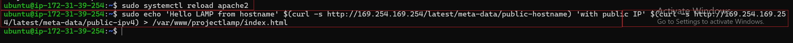

### Created test index.html file to verify the virtual host is working

```bash
sudo echo 'Hello LAMP from hostname' $(curl -s http://169.254.169.254/latest/meta-data/public-hostname) 'with public IP' $(curl -s http://169.254.169.254/latest/meta-data/public-ipv4) > /var/www/projectlamp/index.html
```
### Opening the website in my browser using URL and IP address

```bash
http://13.62.99.206:80

http://ec2-13.62.99.206.eu-north-1.compute.amazonaws.com:80
```
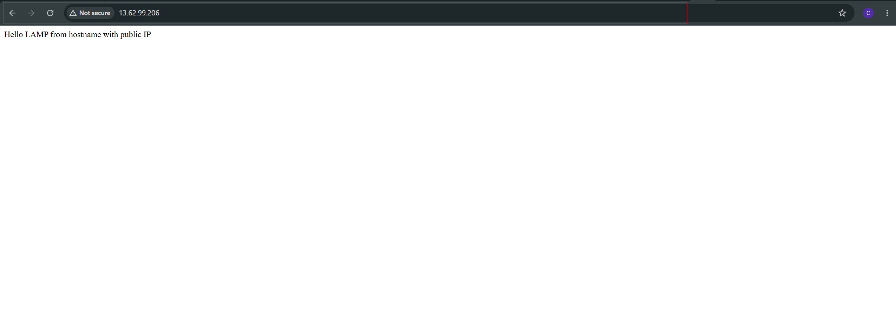
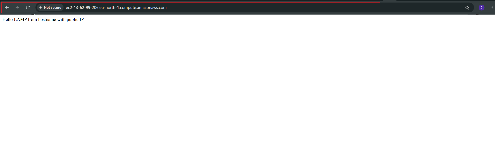

## STEP 5 — ENABLE PHP ON THE WEBSITE:

### The default DirectoryIndex settings on Apache means the file named index.html will always comes before index.php file to change this edit the /etc/apache2/mods-enabled/dir.conf file

```bash
sudo vim /etc/apache2/mods-enabled/dir.conf
```
### Change the DirectoryIndex from: 

```bash
DirectoryIndex index.html index.cgi index.pl index.php index.xhtml index.htm
```
### To this:

```bash
DirectoryIndex index.php index.html index.cgi index.pl index.xhtml index.htm
```
###  Reloading Apache so the changes take effect:

```bash
sudo systemctl reload apache2
```
### Created a PHP test script to confirm that Apache is able to handle and process requests for PHP files.

```bash
vim /var/www/projectlamp/index.php
```
### Add the following text, which is valid PHP code, inside the file:

```bash
<?php
phpinfo();
```
### Refreshed my browser: PHP 8.5.4 info page displayed successfully


### Remove the file i created as it contains sensitive information about my PHP environment and my Ubuntu server.

```bash
sudo rm /var/www/projectlamp/index.php
```

### My LAMP stack project is completely installed and working on EC2 AWS.


